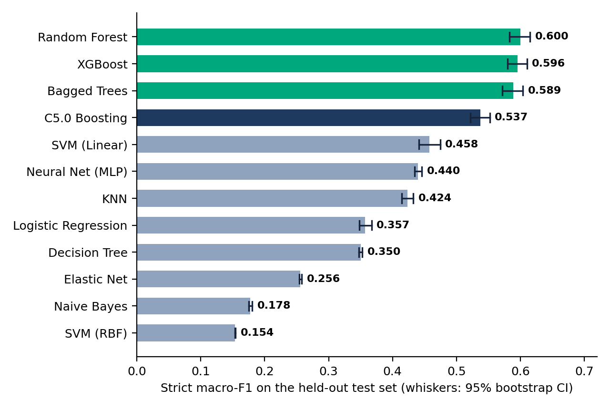
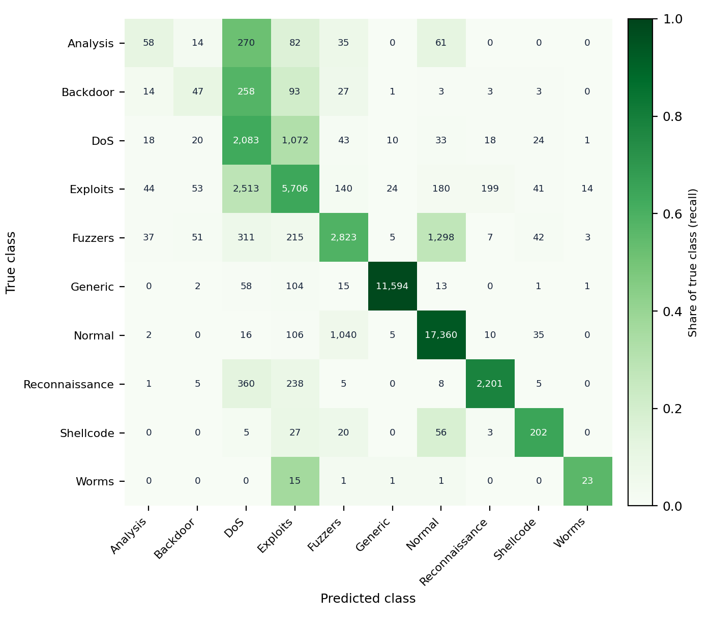

# Network Intrusion Detection on UNSW-NB15

A machine learning pipeline in R that classifies network traffic into normal and nine attack categories using the UNSW-NB15 dataset. It handles severe class imbalance with a tiered SMOTE strategy, compares 12 classifiers with bootstrap confidence intervals, and ships an interactive dashboard for exploring the results.

**Best model:** Random Forest, macro-F1 0.600 (95% CI 0.583 to 0.615), accuracy 0.817 on a held-out test set of 51,536 records that was never resampled.

## Highlights

- **Tiered SMOTE resampling:** per-class oversampling targets instead of one global ratio, so rare attack classes such as Worms are not inflated into unrealistic proportions (133 real training rows become 1,500, not about 37,000).
- **12 classifiers, 8 algorithm families:** linear, regularised linear, tree, bagging and boosting ensembles, instance-based, probabilistic, kernel and neural network models. Five were tuned with grid search and 5-fold cross-validation.
- **Strict macro-F1:** a class a model never predicts counts as zero, rather than being skipped. This changes the ranking: SVM (RBF) and Decision Tree look best in cross-validation but never predict 8 and 5 of the 10 classes.
- **Statistics, not just point estimates:** 95% bootstrap intervals, paired bootstrap comparisons and McNemar tests.
- **SQLite data layer:** processed train and test tables are stored in a database and read back with SQL.
- **Reproducible preprocessing:** a saved `recipes` object keeps training and inference consistent.
- **Dashboard:** model comparison, per-class analysis, feature importance and a live custom attack-scenario tester.

## Dataset

[UNSW-NB15](https://research.unsw.edu.au/projects/unsw-nb15-dataset), created by the Cyber Range Lab of UNSW Canberra. It contains normal traffic and nine attack categories: Fuzzers, Analysis, Backdoors, DoS, Exploits, Generic, Reconnaissance, Shellcode, and Worms (257,673 records, 42 features per flow).

The data is **not included** in this repository because of its size. Download the training and testing sets (`UNSW_NB15_training-set.csv`, `UNSW_NB15_testing-set.csv`) from the link above and place them in the project root.

Two defects in the released files are handled by the pipeline:

- **Swapped file names:** the file called `training-set` is the smaller one (82,332 rows) and `testing-set` is the larger (175,341 rows). The pipeline ignores the names, merges both files and builds its own stratified 80/20 split.
- **Duplicate IDs:** the `id` column restarts in each file, so concatenation creates 82,332 duplicate IDs. The original `id` is dropped and a fresh row identifier is generated.

## Methodology

1. **Data preparation:** merge and clean the two files, split 80/20 stratified by class (seed 42), group rare protocol levels, one-hot encode categoricals, and centre and scale numerics. All fitted steps use the training set only.
2. **Class imbalance:** tiered SMOTE with a separate target per class, applied to the training set only. The test set is never resampled.
3. **Storage:** write the processed tables to SQLite and read them back for modelling.
4. **Modeling:** correlation filter (|r| > 0.9), then 12 classifiers: logistic regression, elastic net, decision tree, Random Forest, bagged trees, XGBoost, C5.0, KNN, Naive Bayes, linear SVM, RBF SVM and a single-hidden-layer MLP. SVM and KNN use a 15% stratified subsample because they do not scale to the full training set.
5. **Evaluation:** strict macro-F1, accuracy, per-class precision, recall and F1, confusion matrices, bootstrap intervals (1,000 paired resamples) and McNemar tests.

## Results

Scored on the held-out test set (51,536 records). Macro-F1 is strict, with 95% bootstrap intervals.

| Model | Accuracy | Macro F1 | 95% CI |
|---|---|---|---|
| Random Forest | 0.817 | 0.600 | 0.583 to 0.615 |
| XGBoost | 0.813 | 0.596 | 0.580 to 0.610 |
| Bagged Trees | 0.812 | 0.589 | 0.572 to 0.604 |
| C5.0 Boosting | 0.745 | 0.537 | 0.522 to 0.552 |
| SVM (Linear) | 0.751 | 0.458 | 0.441 to 0.474 |
| Neural Net (MLP) | 0.762 | 0.440 | 0.435 to 0.446 |
| KNN | 0.707 | 0.424 | 0.414 to 0.432 |
| Logistic Regression | 0.727 | 0.357 | 0.348 to 0.367 |
| Decision Tree | 0.740 | 0.350 | 0.347 to 0.352 |
| Elastic Net | 0.668 | 0.256 | 0.254 to 0.258 |
| Naive Bayes | 0.388 | 0.178 | 0.175 to 0.180 |
| SVM (RBF) | 0.569 | 0.154 | 0.153 to 0.154 |



**Statistical findings**

- Random Forest and XGBoost cannot be separated on macro-F1 (difference 0.004, 95% CI -0.005 to 0.015). Random Forest vs Bagged Trees is borderline (0.011, CI 0.001 to 0.022). All other gaps are 0.063 or larger.
- On a comparable published protocol (pooled files, stratified 80/20 split), Mezher et al. (2026) report 59.16% macro-F1 for XGBoost, in line with these results.

**Random Forest confusion matrix** (rows are true classes, shading shows the share of each true class):



**Hardest classes to detect:** Analysis (F1 0.167), Backdoor (0.147) and DoS (0.453). The matrix shows DoS and Exploits confused in both directions (2,513 Exploits predicted as DoS, 1,072 DoS predicted as Exploits), and Analysis and Backdoor absorbed into them. Analysis and Backdoor received more training rows than Worms or Shellcode yet score far worse, which points to overlapping class signatures rather than data scarcity.

**Rare classes still detected:** 23 of 41 Worms (recall 0.561) and 202 of 313 Shellcode records (recall 0.645). With 41 Worms test records, one record moves recall by 2.4 points, so treat this as indicative.

## Project structure

```
.
├── dashboard/                # Shiny app (needs model files, see below)
│   └── app.R
├── 01_preprocessing.R        # merge, split, encode, normalise, tiered SMOTE
├── 02_eda.R                  # exploratory plots
├── 04_database_setup.R       # write and query the SQLite tables
├── 05_modeling_pipeline.R    # 12 models, tuning, test-set evaluation
├── 06_evaluation_viz.R       # confusion matrix, ROC, PR, feature importance
├── 07_final_analysis.R       # bootstrap CIs, paired tests, McNemar, dashboard data
├── images/                   # figures used in this README
├── .gitignore
└── README.md
```

## Setup

**Requirements:** R 4.x and the packages below.

```r
install.packages(c(
  "tidyverse", "tidymodels", "themis", "janitor", "workflowsets",
  "discrim", "baguette", "kknn", "kernlab", "ranger", "xgboost", "C50",
  "glmnet", "nnet", "naivebayes", "DBI", "RSQLite", "vip", "butcher",
  "shiny", "plotly", "DT"
))
```

Place the dataset CSVs in the project root and run the numbered scripts in order. Expect long runtimes: in the original run the tuning stage took about 14 hours in total, of which the RBF SVM alone took about 10.5 hours.

## Running the dashboard

The trained model, preprocessing recipe and cached test predictions are too large to commit and are hosted as a release asset.

1. Download `dashboard_models.zip` from the [latest release](https://github.com/Dhruuv26/network-intrusion-detection-unsw-nb15/releases/latest).
2. Unzip `rf_model.rds`, `unsw_recipe.rds` and `dashboard_data.rds` into the `dashboard/` folder.
3. Launch the dashboard from R from inside `dashboard/`, or run `shiny::runApp("dashboard")` from the project root.

If the model files are missing, the app stops with a message pointing here.

The dashboard has four tabs: model comparison with bootstrap error bars, per-class analysis with any model's confusion matrix, Random Forest feature importance, and an attack-scenario tester that builds a low-and-slow DoS record from the median normal HTTP flow and shows the class probabilities live.

## Limitations

- Resampling was applied before cross-validation instead of inside each fold, and tuning used a lenient macro-F1 that ignores unpredicted classes.
- No no-resampling baseline, so the benefit of the tiered strategy is not isolated.
- Worms and Shellcode have few test records, so their estimates are volatile.
- Source TTL (`sttl`) is the dominant feature, which may reflect testbed settings rather than attacker behaviour; results may not transfer to real networks.

## Author

**Dhruuv**: B.Tech Computer Science (Data Science), VIT Chennai
GitHub: [@Dhruuv26](https://github.com/Dhruuv26)

## Acknowledgements

Moustafa, N., and Slay, J. (2015). *UNSW-NB15: a comprehensive data set for network intrusion detection systems.* Military Communications and Information Systems Conference (MilCIS), IEEE.
